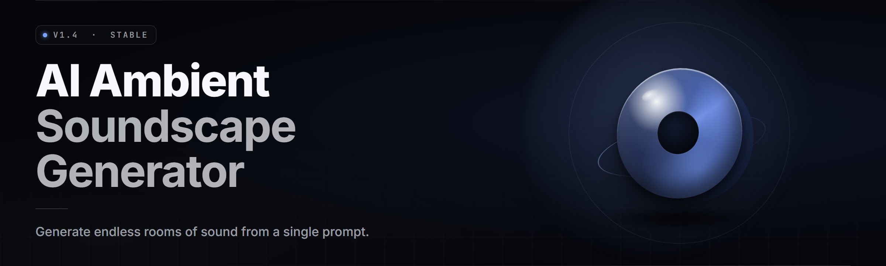

  
  
  

  

  
  
  

---

**Ambient Soundscape Generator 2026** — generative audio that never loops, never repeats, never sleeps.

---

## 🎧 Table of Contents

- [Overview](#-overview)
- [What is Ambient Soundscape Generator](#-what-is-ambient-soundscape-generator)
- [System Support & Audio Backends](#-system-support--audio-backends)
- [Quick Start](#-quick-start)
- [Tips for Best Results](#-tips-for-best-results)
- [Installation](#-installation)
- [Renderer Modules Status](#-renderer-modules-status)
- [Known Issues](#-known-issues)
- [Key Features](#-key-features)
- [Scene Recipe Gallery](#-scene-recipe-gallery)
- [Model Packs & Sources](#-model-packs--sources)
- [The Problem](#-the-problem)
- [The Solution](#-the-solution)
- [Offline vs Streaming Comparison](#-offline-vs-streaming-comparison)
- [FAQ](#-faq)
- [Changelog — 2.6.1](#-changelog--261)

---

## 🌧️ Overview

| Category | Details |
| --- | --- |
| **Type** | Offline generative audio engine for Windows desktop |
| **Core** | Diffusion + neural stem-mixing synthesis pipeline |
| **Input** | Text prompts, mood sliders, timeline automation, loop seeds |
| **Output** | Endless 48 kHz stereo, WAV/FLAC/stream, virtual audio cable |
| **Session Length** | Unlimited — generative, no fixed loop point |
| **GPU Path** | CUDA, DirectML, CPU fallback |

Ambient Soundscape Generator turns a sentence into a living room of sound. You type `rain on a tin roof, distant thunder, low hum` and it renders an infinite, unrepeating texture that shifts like weather. No commercial sampling. No 8-second loops. Every layer is synthesized on demand and stitched into a continuous stream, so you can leave it on for a workday, a sleep cycle, or a TTRPG session and it never arrives twice at the same moment.

  

---

## 🔊 What is Ambient Soundscape Generator

| Term | Explanation |
| --- | --- |
| **Scene** | A named generative preset; a prompt plus parameter payload that publishes audio forever |
| **Stem** | One synthesized layer — rain, wind, hum, bell, crackle — mixed live under the master bus |
| **Neural Renderer** | The diffusion backbone that generates raw audio frames from the prompt embedding |
| **Loop Seed** | A 64-bit integer that fixes the generative random walk so a version of the scene can be replayed |
| **Mood Vector** | A 6-axis slider space (warm/cold, calm/tense, bright/dark, near/far, sparse/dense, wet/dry) |
| **Automation Lane** | A timed envelope that moves sliders over minutes and hours for slowly evolving scenes |
| **Virtual Cable** | An audio device the engine feeds so other apps can capture its stream |

Five things it gives you immediately:

- A texture that runs **for hours without a repeating bar** — no fade-and-restart.
- **Prompt to audio in under 4 seconds** on a mid-range GPU for the first stem.
- **18 world categories** out of the box: weather, forest, city, space, underwater, mechanical, cafe, ruin, and more.
- **Full offline operation** — the engine never pings a sound server, never phones home.
- **Real mixer control per stem**, not a black-box knob.

---

## 📻 System Support & Audio Backends

| Environment | Status | Notes |
| --- | --- | --- |
| Windows 10 (1903+) | ✅ Supported | WASAPI shared + exclusive |
| Windows 11 (22H2+) | ✅ Supported | Default target |
| NVIDIA GPU (RTX 20+) | ✅ Recommended | CUDA 12.x renderer path |
| AMD GPU | ✅ Supported | DirectML renderer path |
| Intel Arc GPU | ✅ Supported | DirectML renderer path |
| CPU-only mode | ✅ Supported | Slower initial render, realtime playback fine |
| Stereo speakers / headphones | ✅ Supported | 2.0 output standard |
| 5.1 / 7.1 surround | ✅ Supported | Surround stem routing available |
| Virtual audio cable | ✅ Supported | For OBS, Discord, DAW capture |
| ASIO low-latency interface | ✅ Supported | For studio monitoring |
| Linux (Wine) | ⚠️ Untested | Community reports vary |

---

## 🧭 Quick Start

1. 📂 **Download and extract** the archive from the landing page to a folder you control — keep the whole folder together.
2. 🖱️ **Run the `.exe`** — first launch provisions the model packs to disk automatically.
3. 🎚️ **Pick a world** from the Scene Library, then type a prompt or drag the mood sliders.
4. ▶️ **Hit Render** — the first stem renders in seconds, the rest stream in behind it.
5. 🔁 **Save the seed** if you like the result, or leave the seed field random to keep the atmosphere unfolding.

---

## 🧊 Tips for Best Results

- Prompt like a director, not a poet — **three to six concrete objects** beats a paragraph of feelings. `cold cave, dripping, low drone` outperforms `a cold feeling of eternity`.
- Turn off **Mood Drift** the first time you listen to a scene. You want to hear the base texture before automation moves it.
- If a render feels muddy on laptop speakers, tilt `near/far` toward near and lift the bell layer — those two sliders fix most mixing at desk distance.
- Set the sleep-timer to close on the slowest lane, not the master bus — abrupt master fades cut busy stems mid-note.
- When mixing into another app, route stems to separate virtual-cable channels and do the fades in your own DAW; the engine mix is for solo listening.
- Give any scene at least **5 minutes of runtime** before you judge it — the generator builds density slowly, and better scenes arrive late.

---

## 📦 Installation

1. **Place the archive contents together.** Extraction matters — the `.exe` and the model pack folder must sit in the same directory. Do not run the executable from inside a zip viewer.
2. **Launch once with a normal user account.** No administrator rights are required unless you plan to write model packs to a protected system folder. If Windows SmartScreen warns on first run, choose *More info → Run anyway* (the build is unsigned by policy).
3. **Confirm the model pack path on first-run setup.** The engine ships two packs: a small base pack for laptop-class machines and a full orchestration pack for GPU workstations. Selecting the base pack is fine — the engine renders smaller textures, but runs everywhere.

---

## 🖥️ Renderer Modules Status

| Module | Status | Description |
| --- | --- | --- |
| Diffusion Core | ✅ Working | Neural backbone that generates frames from the prompt embedding |
| Stem Mixer | ✅ Working | Live bus that layers up to 16 stems with per-channel gain |
| Prompt Frontend | ✅ Working | Boosts and embeds phrases into a mood-agnostic latent |
| Mood Engine | ✅ Working | Maps sliders onto the renderer latent off-axis |
| Automation Lanes | ✅ Working | Timed envelopes over any slider; long-horizon drift |
| Loop Guard | ✅ Working | Detects accidental periodic texture and jitters it away |
| Virtual Cable Bridge | ✅ Working | Routes stream to a chosen capture device |
| Surround Router | ✅ Working | 5.1/7.1 stem assignment |
| Seed Registry | ✅ Working | Persists loop seeds per scene |
| Sample Archiver | ✅ Working | Records a live render to WAV/FLAC |
| Pack Manager | ✅ Working | Adds and culls model packs |
| Scene Library | ✅ Working | Pre-built starter scenes per world |
| Timeline Recorder | ✅ Working | Captures live slider motion into automation |
| Spectrum Tuning | ✅ Working | EQ and spectral shaping via UI |
| Stem Exporter | ✅ Working | Individual stems to disk for DAW sessions |
| Reverb Tank | ✅ Working | Room feedback for "space" scenes |
| Sleep Timer | ✅ Working | Gradual gain-down at the slowest lane |
| Hotkey Panel | ✅ Working | Global keys for mute, scene switch, capture |
| Diagnostics Overlay | ✅ Working | Renderer health, latency, dropouts |

---

## 🧯 Known Issues

| Issue | Solution |
| --- | --- |
| First scene renders slow | The engine is warming the diffusion cache. Second and third scenes are faster. |
| Crackle on CPU-only mode | Increase async buffer size in Settings → Audio; disable mood drift during render. |
| DirectML path fails on older AMD drivers | Update to a driver released in 2025 or later. Fallback to CPU works and plays back in realtime. |
| Virtual cable causes stream sync drift | Disable exclusive mode in the audio backend. |
| Surround routing collapses to stereo | The base model pack is stereo-only; install the full orchestration pack. |
| Sleep timer fires mid-stem | Enable *Wait for lane boundary* under Settings → Timer. |

---

## 🎛️ Key Features

| Feature | Description | Benefit |
| --- | --- | --- |
| **Endless generative stream** | Frames generated on demand, never repeated verbatim | Leave it on for hours without fatigue |
| **Prompt to scenery** | Text prompts seed the latent in one pass | Describe a room, hear it |
| **6-axis mood space** | Move any axis live with sliders | Steer by feel while it plays |
| **Timeline automation** | Draw moves on a long timeline | Slow evolution over an evening |
| **Per-stem real mixer** | Gain, pan, EQ, delay, and reverb per stem | Sculpt the texture, don't accept it |
| **Seeded replay** | Fix a 64-bit seed for scene versions | Keep favorites, jump between takes |
| **Virtual cable output** | Feed the audio into other apps | Capture or live-stream the stream |
| **Sleep-timer aware fades** | Closes on lane boundaries, not bus hard cuts | No mid-stem cliff at lights-out |
| **18 world categories** | Weather, coast, jungle, spaceship, derelict, and more | One library for many moods |
| **Loop Guard** | Anti-periodic jitter on the master bus | Kills the "that's an 8-second loop" tell |
| **Stem export** | Save any stem as WAV/FLAC to disk | Bring the sound into a DAW |
| **Offline-first engine** | No network, no external sound server | Runs on a plane, in a bunker, anywhere |
| **Pack manager** | Add or cull model packs from the UI | Scale with hardware |
| **Diagnostics overlay** | Renderer health, latency, dropped frames | Tune for the machine you have |
| **Realtime slider capture** | Recorded moves become automation lanes | Turn a happy accident into a repeatable scene |
| **Full control offline** | No accounts, no telemetry | Same tool every time you launch |
| **Timeline recorder** | Persist the motion of every slider | Compose a scene without programming |
| **Renderer pack swap** | Move from base to full pack without reinstall | Grow the engine with the machine |

---

## 🗺️ Scene Recipe Gallery

Three example recipes the engine renders verbatim:

**Lighthouse at distance** — `cold north sea, distant bell, wind off stone, one figure, dim lamp`
Stems: wind body, damp stone resonator, bell transient, lamp hum, seabird drift. Mood vector biased cold/near/sparse. Automation closes the bell over 40 minutes and opens the wind alternately.

**Terminal under snow** — `concrete hall, fluorescent flicker, snow against tall glass, pneumatic door at far end`
Stems: hall body, fluorescer flicker, glass resonance, door pneumatics, quiet HVAC. Foreground automation pushes the door closer twice in an hour — enough to feel inhabited.

**Orbital greenhouse** — `warm metal, water on stone, distant pumps, leaves, low orbital hum`
Stems: hull body, drip delay, pump sub, leaf noise, hum shelf. Reverb tank set to a tall cylinder; stem mixer biases near on drip and far on hull.

---

## 🧰 Model Packs & Sources

The engine ships with two packs and accepts drop-in replacement packs from the community.

- **Base Pack** — ~900 MB, stereo, laptop class. Renders all 18 world categories at reduced stem counts.
- **Full Orchestration Pack** — ~3.4 GB, stereo + surround, 16 stems available. GPU recommended.
- **Community Packs** — authored by users and shared as signed archives; drop into the packs folder and the Pack Manager picks them up on next launch.
- **Stem Reprise Packs** — small substitution sets that swap a single stem family (e.g. different rain families) without affecting scene math.

Any pack the engine loads at startup appears under *Settings → Packs*. Unknown packs are held back rather than refused.

---

## 🧩 The Problem

- Every commercial ambience app loops a **pre-recorded stretch** and calls it generative.
- "AI ambience" tools online stream from a **hosted sound server**, so late-night sessions ride on someone else's uptime.
- None of them let you **steer a scene live** — you pick a preset and you live with it.
- Long sessions **fatigue the ear** because nothing substantially changes across an hour.
- Studio quality means a subscription; offline means a folder of `.wav` samples from 2009.
- No per-stem control, so mixing into a session, a stream, or a DAW means exporting and rebuilding the thing by hand.
- Seeds don't exist in consumer tools, so if you loved a take this morning, it is gone by lunch.

---

## 🛠️ The Solution

| Problem | Solution |
| --- | --- |
| Loop-based ambience | Diffusion renders frames on demand — no fixed loop point |
| Hosted sound server | Fully offline engine with local model packs |
| No live control | Six sliders and per-stem mixer, all audible immediately |
| Ear fatigue | Long-horizon automation lanes that unfold over minutes and hours |
| Subscription studio quality | One install, unlimited session length, every module included |
| No DAW-friendly output | Stem export to WAV/FLAC plus virtual cable capture |
| Broken favorite takes | 64-bit loop seed registry keeps dated takes of a scene |

---

## ⚖️ Offline vs Streaming Comparison

| Aspect | Streaming Ambience Tool | This Engine |
| --- | --- | --- |
| Where audio comes from | Remote server over the network | Local generative diffusion |
| Dependence on uptime | Yes — drops in server = silence | None — works offline |
| Latency before play | Buffering delay, then start | Sub-second once first stem renders |
| Loop fatigue | High — same preset from top | Low — generative walk has no top |
| Per-stem live control | Rarely available | Standard on every scene |
| Session length | Bounded by account or tile budget | Unlimited |
| Data use | Streams continuously | Zero after first launch |
| Favorite reproducibility | Often none | Seeded takes stored on disk |

---

## ❔ FAQ

**Q:** Does this need an internet connection?
**A:** No. Once the model pack is provisioned on first launch, the engine runs entirely offline.

**Q:** Can I leave a scene running all night?
**A:** Yes. The engine is designed for continuous playback. Sleep timer closes on lane boundaries so a stem never gets cut mid-tone.

**Q:** Is the audio copyright-free?
**A:** Yes — you generated it. Use it in streams, videos, D&D sessions, wherever.

**Q:** Do I need a GPU?
**A:** No. CPU-only mode plays back in realtime; only the *first* render of a scene is slower.

**Q:** Can I export into a DAW?
**A:** Yes. Export individual stems as WAV/FLAC, or feed the whole stream through a virtual cable.

**Q:** Where do model packs live?
**A:** A `packs/` folder next to the executable. The Pack Manager lists what it finds at startup.

**Q:** Will my favorite scene render identically tomorrow?
**A:** Only with the seed pinned. Unseeded scenes are intentionally non-reproducible.

**Q:** Does the tool page report dropouts in the engine?
**A:** No. Diagnostics stay local on your machine.

**Q:** What if the renderer stalls?
**A:** Open the Diagnostics overlay, look at the diffusion queue depth, and bump the async buffer if the queue is throttled.

**Q:** Are surround and stereo interchangeable mid-session?
**A:** Stereo renders transfer cleanly; surround routing needs the full orchestration pack.

---

## 📝 Changelog — 2.6.1

- Loop Guard jitter tightened on the master bus. Fewer audible periodic tells in long sessions.
- Automation lanes accept frame-accurate nudges.
- Pack Manager now hot-loads packs discovered in `packs/` without a full relaunch.
- Fix: virtual cable no longer drifts sync when exclusive mode is on.
- Fix: sleep timer closes on the lane assigned the lowest gain.

---

## 💾 Get the build

Grab the current release from the project page, extract the archive into a folder you own, and run the `.exe`. First launch provisions model packs; from there the engine is entirely local. Every stem you render is yours.

  

Rendered in 2026 for the session that lasts all night. Feed it a sentence. It answers with a room.
